# ISE-A5: Quality & Security Counterexample Study of the YODA ANN

This study actively tries to **falsify** the fault-tolerance claims made for the YODA artificial neural
network. YODA is the classifier behind the catalogue of new Herbig Ae/Be (PMS) and classical Be (CBe)
star candidates of Vioque et al. (2020, A&A 638, A21,
[doi:10.1051/0004-6361/202037731](https://doi.org/10.1051/0004-6361/202037731)); its code is at
[github.com/MVioque/YODA](https://github.com/MVioque/YODA), commit `0c8097d`.

Course: Intelligent Software Engineering, assignment ISE-A5. The full write-up is
[`report/report.pdf`](report/report.pdf), the platform text is
[`submission_summary.md`](submission_summary.md), and AI use is disclosed in
[`AI_USE_LOG.md`](AI_USE_LOG.md).

> **The model studied is a faithful re-implementation (Route C), not the authors' trained network.**
> No weights or training labels were published. See
> [`docs/reproduction_decision.md`](docs/reproduction_decision.md) and the limits section below.

---

## Contents
1. [Results at a glance](#1-results-at-a-glance)
2. [Assignment requirements: where each one is met](#2-assignment-requirements-where-each-one-is-met)
3. [Rubric mapping](#3-rubric-mapping)
4. [Diagrams: system, faults and method](#4-diagrams-system-faults-and-method)
5. [Results in figures and tables](#5-results-in-figures-and-tables)
6. [Improvement, side effects and residual risk](#6-improvement-side-effects-and-residual-risk)
7. [Limits](#7-limits)
8. [Reproduce from clone to PDF](#8-reproduce-from-clone-to-pdf)
9. [Repository map](#9-repository-map)
10. [Licence notes](#10-licence-notes)

---

## 1. Results at a glance

| Claim (frozen before any experiment) | Baseline verdict | After improvement A | Key evidence |
|---|---|---|---|
| **C1 – fault tolerance**: at paper-realistic fault rates, classes stay stable (flip rate ≤ 5 %) and PMS recall stays within ±2.8 pp | ❌ **Falsified** in 1 of 4 realistic cells | ❌ **Falsified** in 2 of 4 cells | Spurious W3/W4 at the paper's own 44 % rate: **10.5 %** of PMS and **9.5 %** of CBe candidates flip; PMS recall −8.9 pp [−17.8, −2.2] |
| **C2 – boundary robustness**: malformed input fails loudly or is flagged | ❌ **Falsified**: 8 silent failures | ✅ All frozen cases pass (one only nominally) | Impossible magnitudes get normal probabilities; **636/1000** Gaia IDs silently altered by YODA's file I/O, **791/1000** by `Bootgather.py` |

**Negative results**, where the claim held:
- AllWISE mismatches at 2.3 % flip only 1.9 % of candidates.
- IPHAS/VPHAS+ mismatches at 1.3 % flip only 0.2–0.4 %.
- Gaussian W3/W4 noise at 44 % stays below 5 % in the baseline.

**Improvement A** (an input-validation and ID-integrity guard) fixed the C2 failures. It did not fix
C1: it turned part of the *silent* misclassifications into *loud* rejections, which the frozen oracle
still counts as flips.

---

## 2. Assignment requirements: where each one is met

### Required work
| # | Assignment requirement | How it is met | Evidence (file / tag) |
|---|---|---|---|
| 1 | Choose a significant testing or security claim | Two claims from the paper (Sect. 2.4, 5.2) about a catalogue used for telescope follow-up | [`docs/threat_model.md`](docs/threat_model.md), report §1 |
| 2 | **Before any change**, freeze environment, baseline, oracle, attack/fault model, threshold, stopping rule | `uv.lock` + `env.json`; data checksums; protocol frozen and hashed **before** fault injection; student confirmed the thresholds | tags `a5-env`, `a5-protocol-frozen`; [`docs/protocol_v1.md`](docs/protocol_v1.md); [`results/protocol_hash.txt`](results/protocol_hash.txt); [`data/checksums.json`](data/checksums.json) |
| 3 | Execute boundary / abuse / privilege / fault-injection / mutation tests | **Fault injection** F1–F4 (18 cells × 3 seeds) and **boundary/abuse** suite F5 (16 cases, including the *unmodified* original scripts). Privilege is not applicable; the reason is given in the threat model | [`results/baseline/`](results/baseline/), [`src/a5/faults.py`](src/a5/faults.py), [`src/a5/boundary.py`](src/a5/boundary.py) |
| 4 | Apply **one** bounded improvement and rerun the **same** procedure | Guard A in a single commit; `configs/after.yaml` differs from `baseline.yaml` only in `name`, `out_dir` and `guard` | tag `a5-improvement`; [`src/a5/guard.py`](src/a5/guard.py); [`results/after/`](results/after/) |
| 5 | Report failures, rejected candidates, side effects, limits, residual risk | All of these are reported; 4 rejected candidates with reasons | [`docs/improvement_candidates.md`](docs/improvement_candidates.md), [`docs/residual_risk.md`](docs/residual_risk.md), report §6–9 |

### Deliverables
| Deliverable | Location |
|---|---|
| Threat / fault model | [`docs/threat_model.md`](docs/threat_model.md) · diagram in §4 |
| Frozen experimental protocol | [`docs/protocol_v1.md`](docs/protocol_v1.md) (SHA256 in [`results/protocol_hash.txt`](results/protocol_hash.txt)) |
| Raw test / scan / mutation results | [`results/baseline/`](results/baseline/), [`results/after/`](results/after/): `metrics.csv` (one row per seed × cell × set), `per_source/*.npz` (per-source probabilities), `c2_boundary.json`, stdout logs, `failures/` (empty: no crashes) |
| Before / after comparison | notebook §8, report §7, [`report/tables/`](report/tables/), figures in §5 |
| Residual risk and recovery plan | [`docs/residual_risk.md`](docs/residual_risk.md) |

### Common requirements
| Requirement | How it is met |
|---|---|
| Verified end to end | [`results/verification/verification_report.md`](results/verification/verification_report.md): bit-identical independent rerun; 74/74 quoted numbers re-derived by [`scripts/verify_claims.py`](scripts/verify_claims.py); fresh-clone tests; defects found and handled |
| Executable top to bottom | The notebook passes `jupyter nbconvert --execute` with 0 errors in a fresh environment installed from `uv.lock` ([`results/verification/clean_install.txt`](results/verification/clean_install.txt)) |
| Frozen seeds, dependencies, data version, environment | Seeds 11/22/33 with TF op determinism (the after run reproduced the baseline models to ≤ 1.2e-7); `uv.lock`; VizieR checksums for 211 files; SIMBAD label hash |
| Retain failed runs, negative results, challenging evidence | `failures/` directories; [`results/pilot_smoke/`](results/pilot_smoke/) (pre-freeze debug run, disclosed); rerun logs; the nominal Bootgather PASS reported as such |
| Disclose AI tool / task, accepted and rejected advice, independent verification | [`AI_USE_LOG.md`](AI_USE_LOG.md) |
| No fabrication; no credentials or personal data | All numbers are recomputed from raw files; no secrets in the repo (checked with `git grep`); data are not redistributed |
| Submission: 150–300 word summary + repo URL with commit/tag | [`submission_summary.md`](submission_summary.md) (248 words) · tag `a5-final` |
| Repo contains notebook, PDF, source, raw results, AI log | [`notebooks/`](notebooks/), [`report/report.pdf`](report/report.pdf), [`src/`](src/), [`results/`](results/), [`AI_USE_LOG.md`](AI_USE_LOG.md) |

---

## 3. Rubric mapping

| Rubric criterion (points) | Where to look |
|---|---|
| Problem, context and method choice (1.25) | Report §1–3; [`docs/reproduction_decision.md`](docs/reproduction_decision.md) (why Route C); [`docs/threat_model.md`](docs/threat_model.md) (rates traced to the paper; the 28 %/72 % reading corrected) |
| Execution, artifact quality and reproducibility (1.50) | Tags in order; `uv.lock`; checksummed data; 45 pytest tests, including a deliberate-break check ([`results/verification/`](results/verification/)); config-driven runner; executed notebook |
| Analysis, counterexample and limits (1.25) | Bootstrap CIs, paired deltas, transition matrices, flip decomposition, concrete Gaia DR2 counterexamples (§5), limits (§7) |
| Communication, reflection and AI verification (1.00) | This README, the report PDF and [`AI_USE_LOG.md`](AI_USE_LOG.md): accepted/rejected advice, independent verification of each output, student decision points |

---

## 4. Diagrams: system, faults and method

### 4.1 Pipeline and fault-injection points
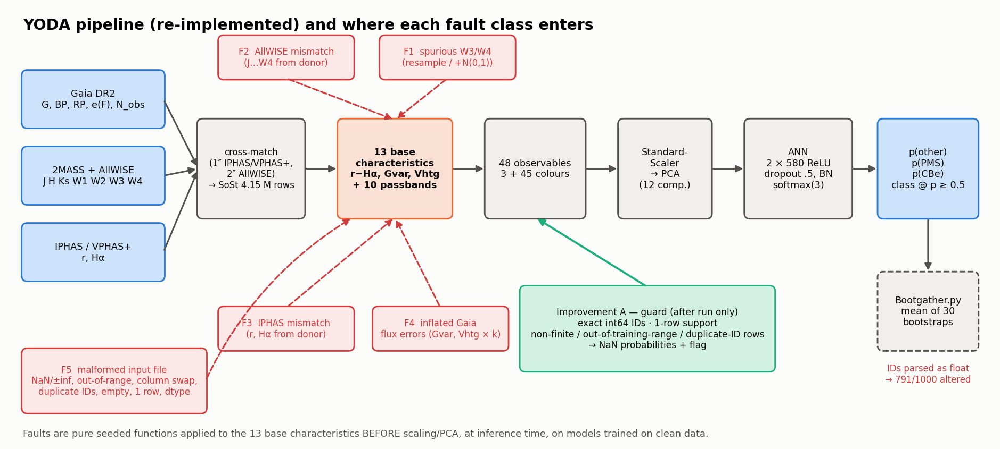

### 4.2 Experimental design
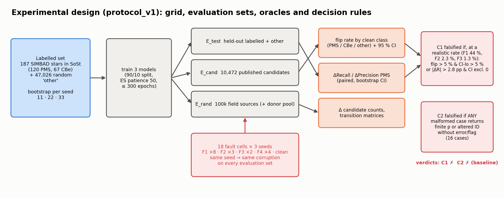

### 4.3 Study workflow, tags and decision points
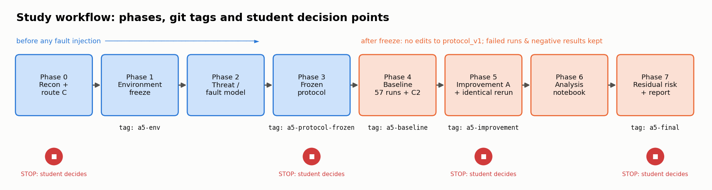

The same workflow as a Mermaid diagram, rendered by GitHub:

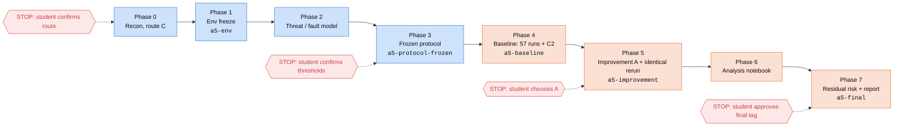

### 4.4 Fault model (summary)
| ID | Mechanism | Rates tested | Rate source (paper Vioque+2020) | Role |
|---|---|---|---|---|
| F1-resample | (W3, W4) replaced by a pair from random field sources | 10, 28, **44**, 72 % | 44 % = `W3W4`-flagged PMS candidates (Sect. 5.2; recomputed 43.5 %); 28 % reliable ⇒ ≈72 % unreliable (Koenig & Leisawitz 2014, as cited) | decides C1 |
| F1-noise | W3, W4 + N(0, 1 mag²) | 10, 28, **44**, 72 % | σ assumed | decides C1 |
| F2 | J, H, Ks, W1–W4 copied from a random field source | 1, **2.3**, 5 % | Sect. 2.4 | decides C1 |
| F3 | r, Hα copied from a random field source | **1.3**, 3 % | Sect. 2.4 | decides C1 |
| F4 | Gaia flux errors × k (so Gvar, Vhtg × k) | k ∈ {2, 5} × {5, 10 %} | none (exploratory) | reported only |
| F5 | 16 malformed or boundary inputs | 1 each | — | decides C2 |

Out of scope, with reasons given in the threat model: adversarial gradient attacks, training-label
poisoning (listed as residual risk R5) and privilege tests (an offline script with no authorisation
surface).

---

## 5. Results in figures and tables

All figures are generated from raw results by
[`scripts/make_figures.py`](scripts/make_figures.py) and [`scripts/make_diagrams.py`](scripts/make_diagrams.py).

### 5.1 C1: flip rate vs fault rate
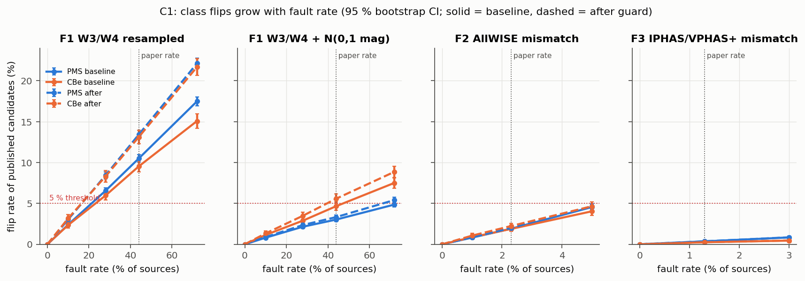

| Realistic cell | PMS flip [95 % CI] | CBe flip [95 % CI] | ΔRecall PMS [95 % CI] | C1 baseline | C1 after |
|---|---|---|---|---|---|
| F1-resample 44 % | **10.5 %** [10.0, 11.0] | **9.5 %** [8.8, 10.2] | **−8.9 pp** [−17.8, −2.2] | ❌ falsified | ❌ (13.4 % / 13.1 %) |
| F1-noise 44 % | 3.0 % [2.8, 3.3] | 4.7 % [4.2, 5.2] | −2.2 pp [−6.7, 0.0] | ✅ survives | ❌ CBe 5.6 % (CI-lo 5.0 %) |
| F2 AllWISE 2.3 % | 1.9 % [1.7, 2.1] | 1.9 % [1.6, 2.2] | −2.4 pp [−7.1, 0.0] | ✅ survives | ✅ survives |
| F3 IPHAS 1.3 % | 0.4 % [0.3, 0.4] | 0.2 % [0.1, 0.4] | 0.0 pp | ✅ survives | ✅ survives |

Full per-cell tables: [`report/tables/cells_baseline.csv`](report/tables/cells_baseline.csv),
[`cells_after.csv`](report/tables/cells_after.csv).

### 5.2 C1 rule (b): change in PMS recall
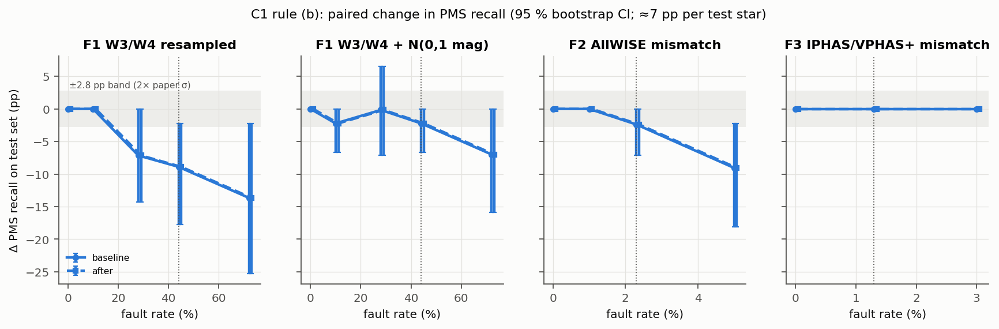

Each test split holds only 14–15 PMS stars, so one star is ≈7 pp of recall and the intervals are wide.
The after-run curves coincide with the baseline because the guard rejected no labelled PMS test star.

### 5.3 Where the flipped candidates go
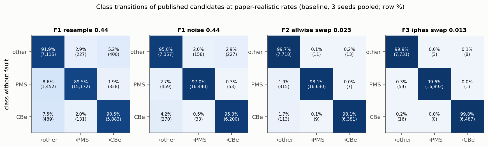

Under W3/W4 resampling, 8.6 % of clean PMS candidates fall to "other" and 1.9 % become CBe; 7.5 % of CBe
fall to "other".

### 5.4 Concrete counterexamples (published candidates, Gaia DR2 IDs)
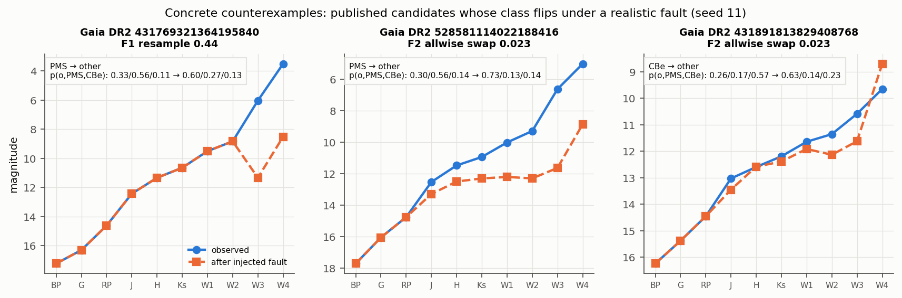

| Gaia DR2 ID | Fault | Class change | p(other / PMS / CBe), before → after |
|---|---|---|---|
| 431769321364195840 | F1-resample: W3 6.03 → 11.33, W4 3.50 → 8.52 | PMS → other | 0.33/0.56/0.11 → 0.60/0.27/0.13 |
| 528581114022188416 | F2: whole AllWISE photometry swapped | PMS → other | 0.30/0.56/0.14 → 0.73/0.13/0.14 |
| 431891813829408768 | F2: whole AllWISE photometry swapped | CBe → other | 0.26/0.17/0.57 → 0.63/0.14/0.23 |

In the F1-resample 44 % cell, 1,011 published candidates flip for seed 11 alone. Every flipped source
had been injected; none flipped by chance.

### 5.5 C2: boundary / malformed-input matrix
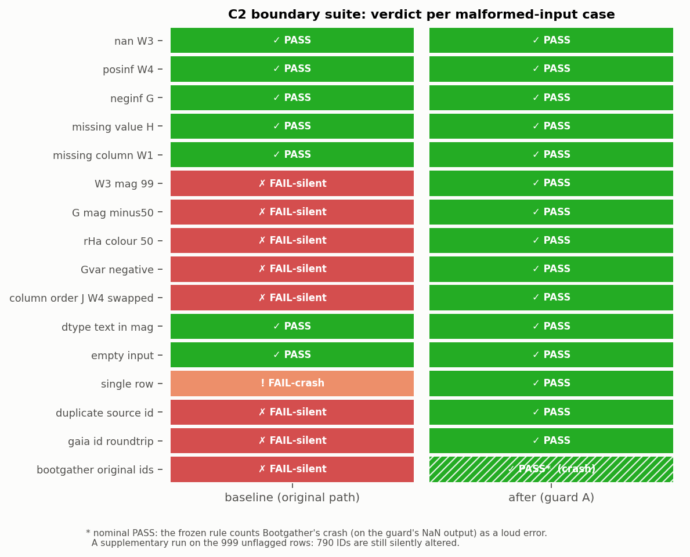

| Case group | Baseline | After guard |
|---|---|---|
| NaN, ±inf, empty field, missing column, text in a magnitude, empty input | PASS (errors raised by NumPy / scikit-learn, not by design) | PASS (flagged or error) |
| W3 = 99, G = −50, r−Hα = 50, Gvar < 0, J/W4 swapped | **FAIL-silent** | PASS (flagged, NaN) |
| Duplicate source ID | **FAIL-silent** | PASS (flagged) |
| 1,000 Gaia IDs through YODA's `loadtxt`/`savetxt` | **FAIL-silent: 636 altered** | PASS: 0 altered |
| Same IDs through the original `Bootgather.py` | **FAIL-silent: 791 altered** | nominal PASS: crash; 790/999 still altered (supplementary run) |
| Single valid row | FAIL-crash | PASS |
| Original `YODA.py` as published | does not run (`keras_metrics` missing, `train_test_split` not imported) | — |

### 5.6 How faithful is the reproduction?
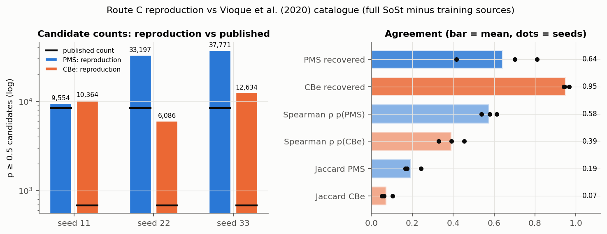

The reproduction recovers 64 % of the published PMS candidates and 95 % of the CBe candidates, but it
flags many more candidates, which is expected with the "other" class at 1/10 size. Spearman ρ is 0.58
for PMS and 0.39 for CBe. Training curves for each seed:

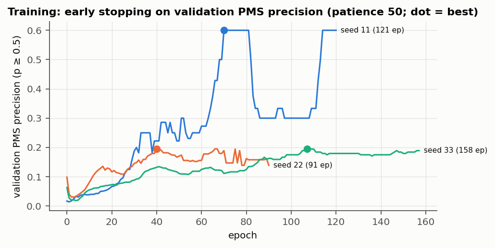

### 5.7 Candidate-count drift
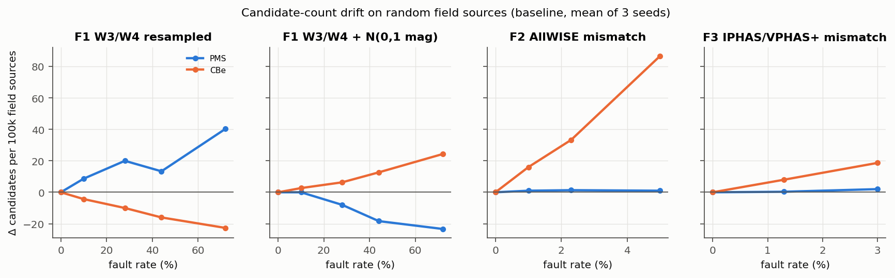

---

## 6. Improvement, side effects and residual risk

| Candidate | Addresses | Decision |
|---|---|---|
| **A – input-validation + ID-integrity guard** | C2 and the single-row crash | ✅ **chosen by the student** |
| B – train-time W3/W4 noise augmentation | C1 (F1) | rejected: circular evidence, retraining needed (recommended as next step) |
| C – AllWISE flag as a feature | C1 (F1) | rejected: effect cannot be measured with this protocol |
| D – post-hoc calibration | probability scale | rejected: does not change the argmax |
| E – drop W3/W4 | C1 (F1) | rejected: mid-IR is needed for PMS/CBe separation |

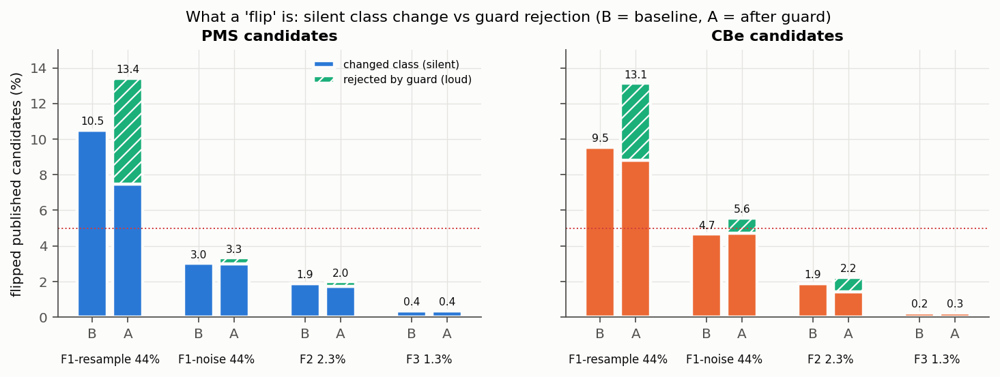

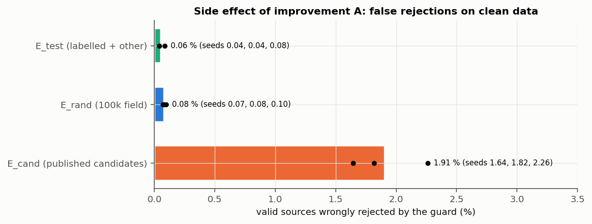

| Side effect of guard A | Value |
|---|---|
| Valid published candidates wrongly rejected | **1.6–2.3 %** (extreme objects are penalised most) |
| Valid field / test sources wrongly rejected | 0.07–0.10 % / 0.04–0.08 % (no labelled PMS or CBe) |
| Clean PMS recall / precision (lower limit) | 74.9 % → 74.9 % / 37.9 % → 38.1 % |
| Clean candidate count (E_rand) | 528.7 → 518.0 per 100k (≈ −2 %) |
| Grid wall time | 647 s → 555 s (within training-time noise) |
| Downstream | the guard's NaN outputs crash the original `Bootgather.py` |

**Residual risks** (full register with likelihood, impact, monitoring and owner in
[`docs/residual_risk.md`](docs/residual_risk.md)):
- **R1:** spurious W3/W4 flipping candidates (unmitigated).
- **R2:** ID corruption in the averaging step.
- **R3:** wrong photometry that stays in range.
- **R4:** false rejections of extreme objects.
- **R5:** label poisoning.
- **R6:** the reproduction gap.
- **R7:** instability across seeds.
- **R8:** the original script does not run.

**Rollback:** `git revert <a5-improvement commit>`, or `git checkout a5-baseline`, or set
`guard: false`. Baseline results are never overwritten.

---

## 7. Limits
- **Reproduction, not the original model.**
  - Only 187 SIMBAD-labelled stars are in the published table, against 848 PMS + 775 CBe in the paper.
  - The candidate overlap with the published catalogue is low (Jaccard 0.19 PMS, 0.07 CBe).
- **Quick mode (student request).** 3 bootstrap models instead of 30, the "other" class at 1/10 size,
  and at most 300 epochs. Absolute recall and precision are not comparable with the paper's
  78.8 % / 40.7 %.
- **Synthetic faults.** These are not real mismatched photometry; the F1-noise σ is assumed.
- **Data vintage.** Gaia DR2-era data; SIMBAD is a live database (queried 2026-11-07).
- **Precision is only a lower limit** (paper Appx. B.1).
- **Downloader defect.** `data/raw/{pms,cbe,either}.tsv` lack VizieR's flag columns because
  `-out.all` was ignored. Only their IDs are used, so no result is affected (see the verification report).
- **Protocol design error.** One ill-posed agreement oracle (Jaccard on E_rand) was recomputed on the
  full table and logged. No decision depends on it.

---

## 8. Reproduce from clone to PDF
Tested on macOS 26 x86_64 (Intel i7-9750H, 16 GB RAM), CPU only. Linux x86_64 is also covered by the
lock file.

```bash
git clone <repo-url> ise-a5-yoda && cd ise-a5-yoda
git checkout a5-final

# 1. Environment: Python 3.12, exact versions from uv.lock
pip install uv==0.13.7
uv sync --frozen

# 2. Data: about 1 GB from a VizieR mirror (CDS Strasbourg may be unreachable). About 15-30 min
#    with 6 workers. Checksums are verified against data/checksums.json.
for i in 0 1 2 3 4 5; do uv run python scripts/download_data.py --shard $i --nshards 6 & done; wait
uv run python scripts/download_data.py --verify
uv run python scripts/build_labels.py   # SIMBAD is a live DB; --verify reports whether it still matches the frozen hash

# 3. Tests (45) and claim verification (74 checks against the raw results)
uv run pytest -q
uv run python scripts/verify_claims.py   # run after step 4

# 4. Experiments: about 10 min each on the machine above
uv run python -m a5.run_experiment configs/baseline.yaml
uv run python -m a5.run_boundary   configs/baseline.yaml
uv run python -m a5.agreement_full configs/baseline.yaml
uv run python -m a5.run_experiment configs/after.yaml
uv run python -m a5.run_boundary   configs/after.yaml
uv run python -m a5.side_effects

# 5. Analysis notebook (runs top to bottom, reading raw results only)
uv run python scripts/make_notebook.py
uv run jupyter nbconvert --to notebook --execute --inplace notebooks/a5_analysis.ipynb

# 6. Figures, diagrams and report PDF (pandoc 3.6.1 ships with the pinned dev dependency
#    pypandoc-binary; needs XeLaTeX, e.g. MacTeX / TeX Live, and the font "Arial Unicode MS")
uv run python scripts/make_figures.py
uv run python scripts/make_diagrams.py
cd report && $(uv run python -c "import pypandoc;print(pypandoc.get_pandoc_path())") report.md -o report.pdf \
    --pdf-engine=xelatex -V mainfont="Arial Unicode MS" -V monofont="Menlo" && cd ..
```

**Determinism.** Seeds are fixed per run (Python, NumPy, TensorFlow) and TF op determinism is on. The
after run retrained with the same seeds, and its clean outputs match the baseline on every unflagged
row (`results/after/side_effects.json`). On other CPUs, floating point results may differ slightly.

---

## 9. Repository map
| Path | Content |
|---|---|
| [`docs/reproduction_decision.md`](docs/reproduction_decision.md) | Phase 0 inventory, route choice, Revision 1 (quick mode) |
| [`docs/threat_model.md`](docs/threat_model.md) | asset, fault classes F1–F5, out-of-scope items |
| [`docs/protocol_v1.md`](docs/protocol_v1.md) | frozen protocol |
| [`docs/improvement_candidates.md`](docs/improvement_candidates.md) | 5 scored candidates, the choice and the rejections |
| [`docs/residual_risk.md`](docs/residual_risk.md) | risk register, recovery and rollback |
| [`src/a5/`](src/a5/) | `pipeline.py` (YODA re-implementation), `faults.py`, `oracles.py`, `guard.py`, `run_experiment.py`, `run_boundary.py`, `boundary.py`, `analysis.py`, `side_effects.py`, `agreement_full.py`, `data.py` |
| [`tests/`](tests/) | exact fault rates, determinism, no input mutation, hand-count on 100 rows, toy oracle example, guard |
| [`configs/`](configs/) | `baseline.yaml`, `after.yaml` |
| [`scripts/`](scripts/) | data download and verification, SIMBAD labels, env record, notebook generator, figures, diagrams |
| [`results/`](results/) | `env.json`, `protocol_hash.txt`, `baseline/`, `after/`, `pilot_smoke/`, `verification/` |
| [`notebooks/a5_analysis.ipynb`](notebooks/a5_analysis.ipynb) | executed analysis (reads raw results only) |
| [`report/`](report/) | `report.md`, `report.pdf`, `figures/`, `tables/` |

Git tags, in order: `a5-env` → `a5-protocol-frozen` → `a5-baseline` → `a5-improvement` → `a5-final`.

## 10. Licence notes
- YODA has **no licence**. It is cited, not redistributed. The C2 suite downloads the two original
  scripts at the pinned commit into `data/external/` (git-ignored) and runs them unmodified.
- Our code is an independent re-implementation under the MIT licence ([`LICENSE`](LICENSE)).
- VizieR and SIMBAD data are used under the CDS terms
  (https://cds.unistra.fr/vizier-org/licences_vizier.html) and are not redistributed. Only the
  checksums are committed.
