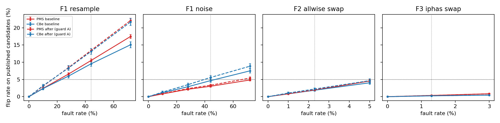

# 1. Claim and motivation

Vioque et al. (2020) trained an artificial neural network (ANN), YODA, on Gaia DR2, 2MASS, AllWISE and
IPHAS/VPHAS+ photometry. They used it to classify 4,150,983 sources as pre-main-sequence (PMS),
classical Be (CBe) or other, and published 8,470 PMS and 693 CBe candidates for spectroscopic
follow-up. The paper acknowledges two families of photometric defects:

- **Spurious W3/W4 photometry:** 44 % of PMS and 27 % of CBe candidates carry a `W3W4` flag.
- **Incorrect cross-matches:** about 2.3 % for AllWISE and 1.3 % for IPHAS/VPHAS+.

It argues that these defects leave the classification largely intact: duplicated matches "do not affect
the classification" (Sect. 2.4), and because many other observables are used, the ANN "can deal
better" with spurious W3/W4 (Sect. 5.2).

We test two claims, frozen before any experiment:

- **C1 (fault tolerance):** at paper-realistic fault rates, the class at p ≥ 0.5 of published
  candidates and of held-out labelled sources stays stable, and PMS recall stays within the paper's
  reported uncertainty.
- **C2 (boundary robustness):** malformed input makes the pipeline fail loudly or flag the input, rather
  than silently returning finite probabilities.

Our C1 extends the paper's "do not affect" wording, which literally concerns *duplicated* matches, to
its *incorrect*-match estimates. It is therefore a deliberately strong reading. The asset at risk is the
candidate list that observers use to spend telescope time.

# 2. System and reproduction route

The YODA repository (commit `0c8097d`, no licence) contains only the training script and an averaging
script. **No trained weights and no labelled training set are public**, and the published script does
not run: `train_test_split` is never imported and it depends on the abandoned `keras_metrics`. We
therefore re-implemented the pipeline line by line (Route C):

- **Features:** 13 base characteristics → 48 observables.
- **Scaling and PCA:** StandardScaler, then PCA with YODA's eigenvalue-ratio rule, which yielded 12
  components as in the paper.
- **Network:** 2 × 580 ReLU layers, dropout 0.5, L2 0.01 and batch normalisation, with full-batch
  Adamax, balanced class weights and early stopping on validation PMS precision (patience 50).

The environment is pinned with `uv.lock` (Python 3.12.15, TensorFlow 2.16.2), runs on CPU only, and
uses fixed seeds with TF op determinism.

The authors' labelled sources are absent from the published VizieR table (Vioque et al. 2020, CDS
J/A+A/638/A21). The IPHAS/VPHAS+ tables could not be reached from any accessible mirror, so we could
not rebuild their photometry. We therefore labelled SIMBAD (Wenger et al. 2000) objects of type
`Ae*`/`TT*` (PMS) and `Be*` (CBe) that are present in the published table. **Only 187 such sources
exist (120 PMS, 67 CBe)**, against the paper's 848 and 775.

At the student's request the study ran in a declared *quick mode*:

- the "other" class at 1/10 of its paper size (47,026);
- at most 300 epochs;
- **3 bootstrap models** (seeds 11, 22, 33) instead of 30.

The reproduction is therefore not the published model. Against the published catalogue, averaged over
seeds and measured on the full table minus training sources:

- **Recovered candidates:** 64 % of published PMS candidates and 95 % of published CBe candidates.
- **Rank correlation (Spearman ρ):** 0.58 for p(PMS) and 0.39 for p(CBe).
- **Candidate-set overlap (Jaccard):** only 0.19 for PMS and 0.07 for CBe. The reproduction flags
  1.1–4.5× more PMS candidates and about 15× more CBe candidates, an expected consequence of the
  smaller "other" class (paper Fig. 2).

Clean test-set PMS recall is 74.9 % and precision 37.9 %. The precision is a lower limit (paper
Appx. B.1). With only 14–15 PMS stars per test split, these metrics are coarse.

# 3. Threat and fault model

All faults are pure, seeded functions applied to the 13 base characteristics before scaling and PCA,
at inference time on models trained on clean data (`docs/threat_model.md`):

| ID | Mechanism | Rates | Rate source |
|---|---|---|---|
| F1-resample | (W3, W4) replaced by a pair from random field sources | 10, 28, **44**, 72 % | 44 %: `W3W4` share of PMS candidates (paper Sect. 5.2; recomputed 43.5 %). 28 %: the *reliable* fraction of Koenig & Leisawitz (2014), as cited by the paper, so 72 % unreliable is the upper stress level |
| F1-noise | N(0, 1 mag²) added to W3, W4 | as F1 | σ is our assumption |
| F2 | J…W4 copied from a random field source | 1, **2.3**, 5 % | paper Sect. 2.4 |
| F3 | r and Hα copied from a random field source | **1.3**, 3 % | paper Sect. 2.4 |
| F4 | Gaia flux errors × k (Gvar and Vhtg × k) | k = 2, 5 at 5, 10 % | exploratory only |
| F5 | 16 malformed or boundary cases (C2) | one each | — |

Out of scope:

- **Adversarial gradient attacks:** no adversary controls survey photometry.
- **Label poisoning:** listed as a residual risk because retraining per poisoning level is outside the
  budget.
- **Privilege tests:** YODA is an offline script with no users, roles, service or credentials, so it
  has no authorisation boundary.

The 28 % figure was verified only through the citing paper. The primary source was not accessible to
automated retrieval.

# 4. Frozen protocol

`docs/protocol_v1.md` was frozen at tag `a5-protocol-frozen`, with its SHA256 stored in
`results/protocol_hash.txt`. The student confirmed the thresholds before any fault injection.

The grid covers 18 fault cells × 3 seeds plus 3 clean runs, evaluated on three sets:

- **E_test:** the held-out labelled and other sources.
- **E_cand:** the 10,472 published candidates.
- **E_rand:** 100,000 random field sources, which also serve as the donor pool for mismatches.

**Oracles:**

- **Flip rate:** the share of sources whose class at p ≥ 0.5 differs from the same model's clean run.
  It is reported separately by clean class, with a 95 % bootstrap CI (2,000 resamples, stratified by
  seed).
- **Recall change:** the paired ΔRecall_PMS, with a bootstrap CI.
- **Candidate counts:** ΔN of p ≥ 0.5 candidates.

**C1 is falsified** if, in any realistic cell (F1 at 44 %, F2 at 2.3 %, F3 at 1.3 %), either:

- the PMS or CBe flip rate exceeds 5 % *and* its CI lower bound also exceeds 5 %; or
- |ΔRecall_PMS| exceeds 2.8 pp (twice the paper's ±1.4) *and* its CI excludes 0.

**C2 is falsified** if any case returns finite probabilities, or an altered identifier, without an
error or flag.

**Stopping rule:** every cell runs to completion and no cell is added or removed.

A pre-freeze smoke run on partial data is disclosed in `results/pilot_smoke/`. One protocol oracle
turned out to be ill-posed: the agreement Jaccard on E_rand is trivially 0, because E_rand excludes all
candidates. It was recomputed on the full table and logged; no decision depends on it.

# 5. Baseline results

All 57 evaluations completed on the first attempt (647 s, no crashes, no reruns).

**C1 is falsified.** It fails in exactly one realistic cell, F1-resample at 44 %:

| Realistic cell | PMS flip [95 % CI] | CBe flip [95 % CI] | ΔRecall_PMS [95 % CI] | C1 |
|---|---|---|---|---|
| F1-resample 44 % | **10.5 %** [10.0, 11.0] | **9.5 %** [8.8, 10.2] | **−8.9 pp** [−17.8, −2.2] | **falsified** (both rules) |
| F1-noise 44 % | 3.0 % [2.8, 3.3] | 4.7 % [4.2, 5.1] | −2.2 pp [−6.7, 0.0] | survives |
| F2 2.3 % | 1.9 % [1.7, 2.1] | 1.9 % [1.6, 2.1] | −2.4 pp [−7.1, 0.0] | survives |
| F3 1.3 % | 0.4 % [0.3, 0.4] | 0.3 % [0.1, 0.4] | 0.0 pp | survives |



Across all faults the response is monotonic:

- **F1-resample:** PMS flips rise from 2.4 % at 10 % to 17.5 % at 72 %.
- **F2:** flips reach 4.5 % at 5 %.
- **F4:** inflating Gaia flux errors mainly moves CBe candidates (2.7 % at k = 5, 10 %), consistent
  with the variability features driving CBe identification.

**Every flipped source was an injected one.** Under a fixed seed, faults never changed an untouched
source's class.

**C2 is falsified.** Eight cases are FAIL-silent:

- **Impossible values:** W3 = 99 mag, G = −50 mag, r−Hα = 50 mag and Gvar < 0 all receive normal
  probabilities.
- **Wrong input layout:** a J/W4 column swap and a duplicated source ID also pass silently.
- **Identifier corruption:**
  - YODA's own `loadtxt`/`savetxt` round trip (IDs parsed as float64) silently altered **636 of 1,000**
    random 19-digit Gaia DR2 IDs. For example, 4293416645328442624 became …442368.
  - The original `Bootgather.py`, run unmodified, altered **791 of 1,000**.

NaN, ±inf, empty fields, a missing column, text in a magnitude and empty input all raise errors, which
counts as PASS. Those errors come from NumPy and scikit-learn rather than from the pipeline's own
design. A single *valid* row crashes the inference step (1-D indexing). This is FAIL-crash: a defect,
but not a C2 falsifier.

# 6. Improvement and rejected candidates

`docs/improvement_candidates.md` scored five candidates written from the baseline failures. The student
chose **A, an input-validation and identifier-integrity guard** on the inference path
(`src/a5/guard.py`, a single commit). It:

- reads and writes IDs as int64;
- accepts one row;
- assigns NaN probabilities and a flag to rows that are non-finite, that fall outside the training
  range of any of the 48 observables ([0.01, 99.99] percentile ± 1 mag), or that repeat an ID.

Rejected candidates:

- **(B) W3/W4 noise augmentation:** the only C1-directed option, but it trains on a fault close to the
  tested one, which makes the evidence circular.
- **(C) AllWISE flag as a feature:** its effect cannot be measured, because the faults leave flags
  untouched.
- **(D) Post-hoc calibration:** it does not change the argmax.
- **(E) Dropping W3/W4:** the mid-IR is needed for PMS/CBe separation (paper Sect. 5.4).

# 7. Before / after (identical protocol)

The after run retrained with the same seeds. On unflagged rows its clean probabilities match the
baseline to ≤ 1.2 × 10⁻⁷, with zero class changes. This is an end-to-end determinism check.

**C2 now passes every frozen case:**

- All malformed values and the column swap are flagged.
- The duplicate ID is flagged.
- One row works.
- **0 of 1,000 IDs are altered** on the inference path.

Two qualifications apply:

- **The Bootgather PASS is only nominal.** The original Bootgather.py now *crashes* because the guard
  writes NaN for one of the 1,000 rows. The frozen rule counts that as PASS, but a supplementary run on
  the 999 unflagged rows shows that **790 IDs are still silently corrupted**. The aggregation defect is
  unresolved.
- **The missing-column case passes indirectly.** It is caught by the range check after pandas shifts
  the columns, not by an explicit column test.

**C1 gets worse under the frozen oracle.** At F1-resample 44 % the PMS flip rate rises from 10.5 % to
13.4 % and the CBe flip rate from 9.5 % to 13.1 %. The CBe flip at F1-noise 44 % (5.6 %, CI lower
bound 5.0 %) now also crosses the threshold, so two realistic cells falsify C1.

Separating the two kinds of flip explains why:

| F1-resample 44 % | PMS rejected by guard | PMS → other class | CBe rejected | CBe → other class |
|---|---|---|---|---|
| Baseline | 0 % | 10.5 % | 0 % | 9.5 % |
| After guard | 5.9 % | 7.5 % | 4.3 % | 8.8 % |

The guard converts part of the *silent* misclassification into *loud* rejection. Resampled W3/W4 often
produce colour combinations outside the training range. But the protocol counts a rejection as a flip,
and at least 7.5 % of PMS candidates still change class silently. ΔRecall is unchanged, because no
labelled test PMS star was rejected.

# 8. Counterexamples and negative results

Concrete counterexamples come from model seed 11 (all listed in the notebook):

- **Gaia DR2 431769321364195840**, a published PMS candidate: p(PMS) falls from 0.56 to 0.27 when its
  (W3, W4) of (6.03, 3.50) mag are replaced by (11.33, 8.52). It becomes "other".
- **Gaia DR2 528581114022188416**, PMS: p(PMS) falls from 0.56 to 0.13 when its AllWISE photometry is
  swapped.
- **Gaia DR2 431891813829408768**, CBe: p(CBe) falls from 0.57 to 0.23 under the same AllWISE fault.

In the F1-resample 44 % cell, 1,011 published candidates flip for this seed alone.

Negative results, which did *not* falsify:

- AllWISE mismatches at 2.3 % and IPHAS/VPHAS+ mismatches at 1.3 % stay well below the 5 % threshold.
- Gaussian W3/W4 noise at 44 % stays below it in the baseline.

The paper's robustness argument therefore holds for cross-match errors at the reported rates, and
fails for spurious mid-IR photometry at the reported rate.

# 9. Side effects, limits, residual risk

**Side effects of the guard:**

- **Wrongly rejected valid sources:** 0.07–0.10 % of random field sources, 0.04–0.08 % of test sources
  (no labelled PMS or CBe), and **1.6–2.3 % of published candidates**. The candidates are extreme
  objects, which a training-range check penalises most.
- **Candidate count:** the clean candidate count on E_rand drops by about 2 % (528.7 → 518.0 on
  average).
- **Precision:** the precision lower limit is essentially unchanged (37.9 % → 38.1 %).
- **Runtime:** the grid ran in 555 s against 647 s for the baseline (the difference is within
  training-time noise).
- **Downstream:** the guard's NaN outputs break the original averaging script.

**Limits:**

- the reproduction is not the original model, and its candidate overlap is low;
- 187 labels and 3 bootstrap models instead of 30, so recall is resolved only to about 7 pp per test
  star;
- the faults are synthetic and the noise σ is assumed;
- the data are from the Gaia DR2 era and SIMBAD is a live database;
- precision is only a lower limit.

`docs/residual_risk.md` lists eight residual risks with likelihood, impact, monitoring, owner and a
rollback plan. The leading ones are:

- spurious W3/W4 flipping candidates (unmitigated);
- ID corruption in the averaging step;
- in-range wrong photometry;
- false rejections of extreme objects.

# 10. Reproduction

`README.md` gives every command from clone to PDF:

```
uv sync --frozen
python scripts/download_data.py      # resumable, checksum-verified against data/checksums.json
python scripts/build_labels.py
pytest -q
python -m a5.run_experiment configs/{baseline,after}.yaml
python -m a5.run_boundary configs/{baseline,after}.yaml
python -m a5.agreement_full configs/baseline.yaml
python -m a5.side_effects
jupyter nbconvert --execute notebooks/a5_analysis.ipynb
```

The notebook reads only the raw results. It executed without errors in a freshly installed environment.

# References

All DOIs were resolved and their metadata checked on 2026-11-07 (`results/verification/doi_check.txt`).

- Barentsen, G., et al. 2014, MNRAS, 444, 3230. The second data release of the INT Photometric Hα Survey of the Northern Galactic Plane (IPHAS DR2). doi:10.1093/mnras/stu1651
- Drew, J. E., et al. 2014, MNRAS, 440, 2036. The VST Photometric Hα Survey of the Southern Galactic Plane and Bulge (VPHAS+). doi:10.1093/mnras/stu394
- Efron, B., & Tibshirani, R. J. 1993, *An Introduction to the Bootstrap*, Chapman & Hall. doi:10.1007/978-1-4899-4541-9
- Gaia Collaboration, Brown, A. G. A., et al. 2018, A&A, 616, A1. Gaia Data Release 2. doi:10.1051/0004-6361/201833051
- Kingma, D. P., & Ba, J. 2014, Adam: a method for stochastic optimization, arXiv:1412.6980. doi:10.48550/arXiv.1412.6980
- Koenig, X. P., & Leisawitz, D. T. 2014, ApJ, 791, 131. doi:10.1088/0004-637X/791/2/131. *The DOI resolves, but the ≈28 % figure was verified only as cited by Vioque et al. (2020).*
- Marton, G., et al. 2019, MNRAS, 487, 2522. doi:10.1093/mnras/stz1301
- Vioque, M., et al. 2018, A&A, 620, A128. Gaia DR2 study of Herbig Ae/Be stars. doi:10.1051/0004-6361/201832870
- Vioque, M., Oudmaijer, R. D., Schreiner, M., et al. 2020, A&A, 638, A21. Catalogue of new Herbig Ae/Be and classical Be stars. A machine learning approach to Gaia DR2. doi:10.1051/0004-6361/202037731 (arXiv: doi:10.48550/arXiv.2005.01727)
- Vioque, M., et al. 2020, VizieR On-line Data Catalog J/A+A/638/A21. doi:10.26093/cds/vizier.36380021
- Wenger, M., et al. 2000, A&AS, 143, 9. The SIMBAD astronomical database. doi:10.1051/aas:2000332
- IRSA 2020, AllWISE Source Catalog. doi:10.26131/IRSA1
- Software: YODA, https://github.com/MVioque/YODA (commit 0c8097d, no licence); TensorFlow 2.16.2 / Keras 3; scikit-learn 1.5.2; uv 0.13.7.
